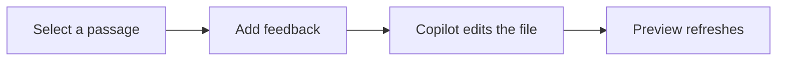

# Review a document in context

Select **this passage** and tell Copilot what you want changed. Comments keep the selected quote and its source location, so you do not need to describe the section in chat.

## How it works

1. Open any local Markdown document in this canvas.
2. Select text, choose **New comment**, then pick a feedback prompt or enter your own.
3. Copilot receives the selected passage, file path, source lines, and feedback.
4. The comment stays beside its passage until Copilot verifies the edit and resolves it.

## A passage to improve

In today's rapidly evolving landscape, it is important to note that leveraging a robust and comprehensive approach can unlock a wide range of significant benefits.

Try **Fix this slop** on that paragraph, **Provide more context** on the workflow, or **Rewrite** on any sentence. Use **Comment on diagram** to open a comment beside the Mermaid diagram.

> Feedback is sent to the current Copilot conversation. The agent uses its normal permission flow. A sent comment is not proof that the edit is complete.
