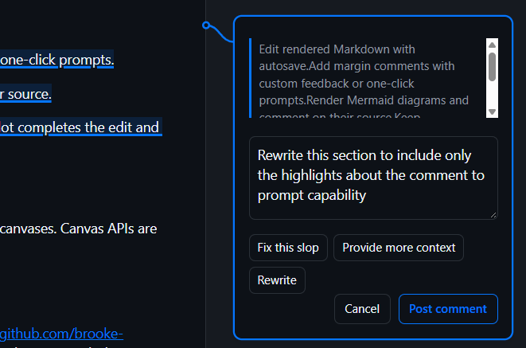

# Markdown comments Copilot App Canvas Extension

Use Microsoft Word-style document comments to give Copilot context-specific prompts for Markdown documents within the GitHub Copilot app. Select a passage, add a comment, and let Copilot update the file in your current conversation.



## How to use

1. Ask Copilot: "Open \<document name> in the Markdown comments canvas," replacing the \<document name> with your document's name.
2. Select text and choose **New comment**, or press **Ctrl+Alt+M** (**Cmd+Option+M** on Mac).
3. Write your feedback prompt, then choose **Post comment** (or select one of the customizable one-click prompts).
4. Review the updated document after Copilot makes the changes. Copilot receives the passage, source location, and feedback; the comment stays open until Copilot verifies the edit and resolves it.

Use **Comment on diagram** for Mermaid feedback and **Show resolved / history** to revisit previous comments. Customize one-click prompts in `feedback.json`.

**Keep in mind:** This is an experimental editor, not a fully lossless Markdown editor. Wait for **Saved** before closing; unsaved drafts have no crash recovery. Conflicting external edits require manual resolution.

Comments are stored locally under the extension's `artifacts\` directory. Posting feedback sends the selected text and source context to Copilot and its configured model provider, using the conversation's normal permissions. External images are not loaded.

## Install

Requires a GitHub Copilot app that supports extension canvases. Canvas APIs are experimental.

### Plugin marketplace (recommended)

Run these commands with the Copilot CLI:

```console
copilot plugin marketplace add brooke-hamilton/markdown-comments
copilot plugin install markdown-comments@markdown-comments-plugins
```

Reload extensions in the Copilot app after installing. The plugin includes built browser assets and bundled runtime dependencies; no npm install or local build is needed. The CLI alone cannot display the canvas.

The marketplace installs from the generated `dist` branch. It becomes available after the **Publish plugin** workflow runs on `main`; before the first publish, marketplace installation will not work.

To update:

```console
copilot plugin marketplace update markdown-comments-plugins
copilot plugin update markdown-comments@markdown-comments-plugins
```

To uninstall:

```console
copilot plugin uninstall markdown-comments@markdown-comments-plugins
```

Reload extensions after updating or uninstalling. Plugin-managed files may be replaced or removed during these operations. Back up custom `feedback.json` settings and comment history from the extension's `artifacts` directory first. Your Markdown documents remain in their original locations.

If you previously copied or imported the extension into your user extensions directory, remove that older installation before installing the plugin so two providers do not register the same canvas. Back up its settings and comment history first; the plugin does not migrate them automatically.

### Manual installation

Ask Copilot:

> Install the Markdown comments canvas from https://github.com/brooke-hamilton/markdown-comments in my user extensions directory, including any required dependencies and built assets, then reload extensions.

Ask Copilot to open the installed extension's `examples\welcome.md` for a sample document.

### Building the plugin

With Node.js 22.12 or later, run `npm ci`, then `npm run build:release`. The output is a self-contained plugin in `release\`, with its canvas under `.github\extensions\markdown-comments`. The output directory must not already exist; an alternative destination can be supplied with `npm run build:release -- <directory>`. Only allowlisted runtime files and generated assets are included, not local comment history or documents. The plugin version combines the package version with the source commit's short SHA.

## License

[MIT](LICENSE)
